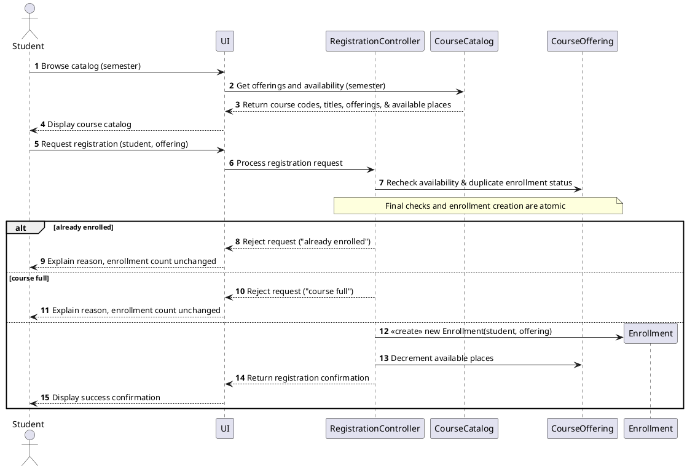
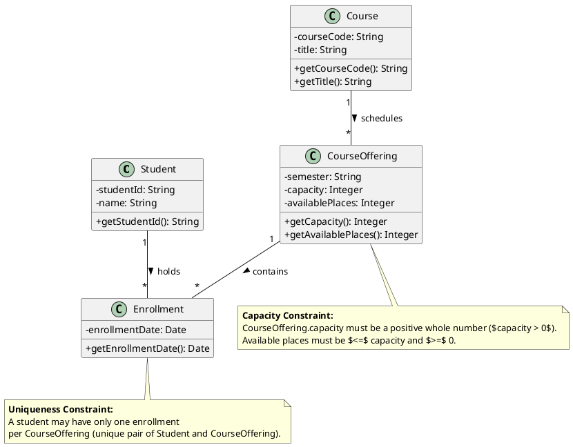
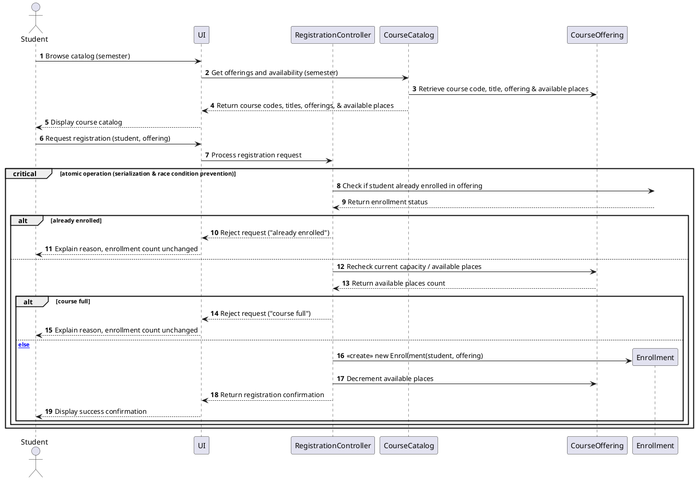
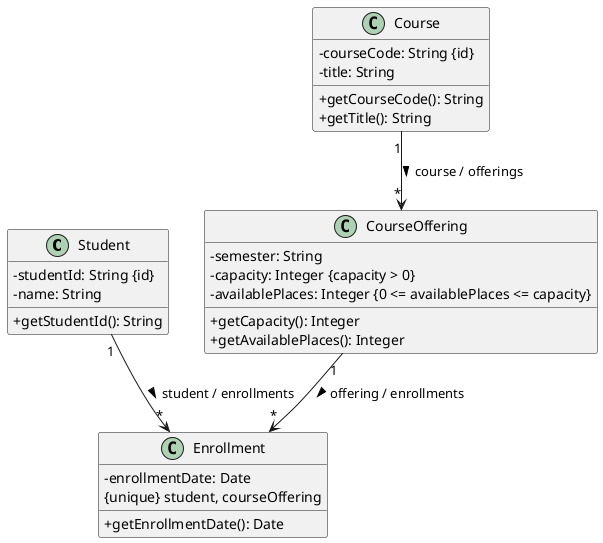

# SIS #02 — AI-Assisted UML Modeling: University Course Registration

<!--
  This is the only file you write your report in. README.md tells you what goes where.

  Rules the checker relies on:
  - Do not delete, rename or renumber the ## headings, the ### headings, or the **Label:** words.
  - Replace every "(write here)" and "(paste here)". None may be left when you submit.
  - Comments like this one are ignored by the checker and the word counter. Delete them or leave them.
-->

## 1. Scope and assumptions

**Scope:** This project models university course registration. Students browse a semester's course catalog, select a specific course offering, and request enrollment. The system checks current capacity and duplicate enrollment before accepting or rejecting a registration request. It supports successful registration and clear rejection for full courses or duplicate requests. Payments, prerequisites, timetable clashes, waiting lists, and cancellation are outside the scope.

**Assumptions:**

1. Students are already signed in, and the selected course offering exists with a positive whole-number capacity.
2. A Course represents a subject, while a CourseOffering represents a specific scheduled section in one semester.

## 2. User stories and acceptance criteria

### US-01 — Browse offerings

**US-01:** As a signed-in student, I want to browse the electronic course catalog for a semester, so that I can see course codes, titles, specific offerings, and available places before deciding to register.

- **AC-01** (R1): Given a signed-in student is browsing the course catalog for a specific semester, When the catalog is loaded, Then the system displays the course code, title, offering, and available places for each course offering.
- **AC-02** (R1): Given a student is viewing available places in the catalog without making a registration request, When the view is rendered, Then no places are reserved or modified.

### US-02 — Register for an offering

**US-02:** As a signed-in student, I want to request enrollment in a specific course offering, so that I can secure a place if capacity allows.

- **AC-03** (R2, R4): Given a signed-in student selects an offering with available capacity and is not already enrolled, When they submit a registration request, Then the system atomically rechecks availability, creates exactly one enrollment linking the student and offering, updates available places, and returns a confirmation.
- **AC-04** (R2, R4): Given competing registration requests target the last remaining place of an offering, When the final checks and enrollment creation are processed, Then the operation executes atomically so that only one request succeeds and capacity is never exceeded.

### US-03 — Receive a clear rejection

**US-03:** As a signed-in student, I want the system to reject invalid enrollment requests with clear explanations, so that my enrollment status remains unchanged if a course is full or if I am already enrolled.

- **AC-05** (R2, R5): Given an offering has zero available places, When a student requests enrollment, Then the system rejects the request, explains "course full", creates no enrollment, and leaves the enrollment count unchanged.
- **AC-06** (R3, R5): Given a student is already enrolled in the selected offering, When the student submits a repeat enrollment request, Then the system rejects the request, explains "already enrolled", creates no new enrollment, and leaves the enrollment count unchanged.


## 3. Sequence diagram


**Participants:** Student is the actor who browses the catalog and requests registration. UI displays the catalog and registration results. CourseCatalog retrieves course offerings for the selected semester. RegistrationController processes the registration request and coordinates the checks. Enrollment is used to check existing enrollments and create a new enrollment record. CourseOffering provides current availability and capacity information.

**Atomic operation:** The final duplicate-enrollment check, capacity check, and Enrollment creation must be processed atomically. This prevents two concurrent requests from taking the same last available place and ensures that capacity is never exceeded. The system first checks whether the student is already enrolled. If not, it checks the current availability. If the offering is full, the request is rejected without creating an Enrollment or changing the count. Otherwise, the system creates one Enrollment and updates the available places. Browsing the catalog only displays availability; it does not reserve a place because availability may change before registration.

**Where the Enrollment is created:** After both checks succeed, RegistrationController sends the `<<create>> new Enrollment(student, offering)` message to the Enrollment lifeline. This creates an instance of the `Enrollment` class shown in section 4. The available-place count is updated, and confirmation is returned only after the creation step.

**Technical lifelines:** UI, CourseCatalog, and RegistrationController are technical lifelines rather than domain classes in the class diagram. UI represents the user interface, CourseCatalog represents the service that retrieves catalog information, and RegistrationController coordinates the registration workflow. These lifelines are included in the sequence diagram to show how the system processes a request; the class diagram focuses on the core domain concepts: Student, Course, CourseOffering, and Enrollment.


## 4. Class diagram


| Association | Read left to right | Read right to left |
| --- | --- | --- |
| Course — CourseOffering | One Course can have many CourseOfferings. | Each CourseOffering belongs to exactly one Course. |
| CourseOffering — Enrollment | One CourseOffering can have many Enrollments. | Each Enrollment refers to exactly one CourseOffering. |
| Student — Enrollment | One Student can have many Enrollments. | Each Enrollment refers to exactly one Student. |

**How an Enrollment links a student to an offering:** Each Enrollment represents one student's registration for one specific CourseOffering. It connects exactly one Student with exactly one CourseOffering. The Enrollment record stores the registration date. This association allows the system to identify which student registered for which offering and to check whether the same student has already enrolled in it.

**Capacity constraint:** The capacity of each CourseOffering must be a positive whole number. The number of available places must remain between zero and the total capacity, inclusive. Multiplicity alone cannot express these numerical restrictions because multiplicity describes how many object instances may participate in an association, not the permitted values of attributes or the maximum number of enrollments determined by capacity.

**Uniqueness constraint:** A student may have at most one Enrollment for the same CourseOffering. The combination of Student and CourseOffering must therefore be unique across Enrollment records. Multiplicity alone cannot prevent duplicate records for the same student-offering pair because it does not enforce uniqueness of that combination.

## 5. Traceability

| Rule and criterion | Model evidence | Validation case |
| --- | --- | --- |
| R1 + AC-01, AC-02 | Sequence diagram: `Browse catalog (semester)` and `Get offerings and availability (semester)`; Course, CourseOffering and their attributes in the class diagram. Catalog browsing displays available places without reserving them. | Extra check: inspect the catalog response for course code, title, offering and available places; confirm that browsing does not change enrollment counts. |
| R2 + AC-03, AC-04, AC-05 | Sequence diagram: current availability is checked after the registration request and before Enrollment creation. The atomic operation protects the capacity check and creation from competing requests. | T1, T2, T3 |
| R3 + AC-06 | Sequence diagram: `Check if student already enrolled in offering` precedes the creation step; the duplicate branch rejects the request. Enrollment links one Student to one CourseOffering. | T4 |
| R4 + AC-03, AC-04 | Sequence diagram: `<<create>> new Enrollment(student, offering)`, followed by the available-place update and registration confirmation. Class diagram: Enrollment is associated with Student and CourseOffering. | T1, T2 |
| R5 + AC-05, AC-06 | Sequence diagram: `already enrolled` and `course full` rejection branches return the reason without creating an Enrollment or changing the enrollment count. | T3, T4 |


## 6. Walkthroughs

| Case | Observed path and state change | Judgment and evidence |
| --- | --- | --- |
| T1. Available | The student browses the catalog, selects an offering with capacity 2 and 0 existing enrollments, and requests registration. The controller checks for duplicate enrollment, receives a negative result, checks current availability, and receives 2 available places. It creates one Enrollment, decrements available places, and returns confirmation. Enrollment count: 0 → 1; available places: 2 → 1. | Pass — sequence diagram: `Check if student already enrolled in offering`, `Recheck current capacity / available places`, `<<create>> new Enrollment(student, offering)`, and the success confirmation. |
| T2. Last place | The student requests registration for an offering with capacity 2 and 1 existing enrollment. The duplicate check finds no existing enrollment for this student. The capacity check returns 1 available place. The controller creates one Enrollment, updates availability, and returns confirmation. Enrollment count: 1 → 2; available places: 1 → 0. | Pass — sequence diagram: the successful branch after the duplicate and capacity checks, followed by Enrollment creation and confirmation. |
| T3. Full | The catalog previously displayed an available place, but another registration takes it before this student submits a request. The current enrollment count is 2 for capacity 2. The duplicate check returns a negative result, and the current capacity check returns 0 available places. The controller rejects the request with `course full` and creates no Enrollment. Enrollment count: 2 → 2; available places: 0 → 0. | Pass — sequence diagram: the `course full` rejection branch after the current availability check. No creation or availability update occurs on this path. |
| T4. Duplicate | A student who already has an Enrollment for the selected offering submits the same request again. The controller checks existing enrollments and receives a positive result. It rejects the request with `already enrolled` before checking capacity for creation. Enrollment count remains 1 → 1; available places remain unchanged. | Pass — sequence diagram: the `already enrolled` rejection branch following `Check if student already enrolled in offering`. No new Enrollment or availability update occurs. |

## 7. Review decisions

| AI suggestion or model element | Decision | Reason | Rule |
| --- | --- | --- | --- |
| C-01: Make the atomic registration operation explicit in the sequence diagram. | Accepted | The final duplicate check, capacity check, and Enrollment creation must be atomic so that concurrent requests cannot exceed the offering's capacity. | R2, R4 |
| C-02: Represent capacity and uniqueness constraints in the class diagram. | Modified | I represented capacity bounds and the unique Student–CourseOffering pair as separate constraints because association multiplicities alone cannot enforce these business rules. | R2, R3 |
| C-04: Split the duplicate-enrollment check and capacity check into separate messages. | Accepted | Separate messages make the registration decision easier to follow and show that the system checks for an existing enrollment before attempting to create another one. | R2, R3 |

## 8. Modeling explanation

The class diagram and sequence diagram describe complementary views of the university course registration system. The class diagram shows the static structure, while the sequence diagram explains how the system behaves when a student requests registration.

The class diagram contains four domain classes: Student, Course, CourseOffering, and Enrollment. Student represents a registered student, and Course describes a subject through its code and title. CourseOffering represents a specific section in a semester and stores its capacity and available places. Enrollment represents one student's registration for one offering. Separating Course from CourseOffering is important because the same subject may be available in different semesters or sections. Each Enrollment links exactly one Student with exactly one CourseOffering.

The sequence diagram shows the registration workflow. First, the student browses the catalog and sees course information and current availability. Browsing does not reserve a place because availability may change before registration. After receiving a request, the system checks whether the student is already enrolled and then checks current capacity. If the student is already enrolled or the offering is full, the system rejects the request without creating another Enrollment or changing the count. Otherwise, it creates one Enrollment, updates available places, and returns confirmation.

The final checks and creation must form one atomic operation to prevent concurrent requests from exceeding capacity. The class diagram represents structural relationships and business constraints, while the sequence diagram shows when the rules are checked.

An activity diagram could also explain the workflow by showing the decisions for duplicate enrollment, course availability, successful registration, and rejection. It would clarify the control flow, but it would not replace the class diagram's structural information or the sequence diagram's message order.


## 9. Reflection

AI helped me organize the requirements and create the first versions of the UML diagrams. It was useful for identifying the main classes, attributes, relationships, and messages in the course registration process. It also helped me understand how the class diagram and sequence diagram describe different aspects of the same system.

However, I learned that AI-generated diagrams must be checked against the requirements. The first sequence diagram combined the duplicate-enrollment check and capacity check into one message. I decided to separate these checks because their order affects the registration decision. I also reviewed the capacity and uniqueness constraints because incorrect modeling could allow duplicate registrations or too many students in an offering.

One limitation is that a UML diagram cannot guarantee that a real application handles concurrent registration requests safely. The implementation would need appropriate transaction and database mechanisms. The diagrams also simplify the university registration process and exclude prerequisites, timetable conflicts, and waiting lists.

This task taught me to use AI as a modeling assistant rather than the final authority. Requirements, diagram syntax, and business rules still need careful human review.

## 10. Appendix A — Before AI

**Scope:** This project models university course registration. Students browse a semester's course catalog, select a specific course offering, and request enrollment. The system checks available capacity and duplicate enrollment before accepting or rejecting a registration request.

**Initial assumptions:**

1. Students are already signed in, and the selected course offering exists with a positive whole-number capacity.
2. A Course represents a subject, while a CourseOffering represents a specific scheduled section in one semester.


## 11. Appendix B — AI exchanges

<!-- Complete prompts and complete responses, as text — never screenshots. Paste each inside
     the ~~~~ block that follows its label: AI responses contain ``` PlantUML blocks, and
     ~~~~ keeps them from breaking this file. Prompts B and C: the prompt text first, then
     the material it refers to ("below", "these two") pasted under it, in the same block.
     You may add B5, B6 … after B4 if you ran more. -->

### B1 — Requirements (Prompt A)

- **Tool:** Gemini
- **Model:** Gemini 3
- **Date:** 2026-10-18
- **Purpose:** draft 3 user stories and 6 acceptance criteria

<!-- Model: the exact model with its version, as the tool shows it (e.g. "GPT-5 Thinking",
     "Claude Sonnet 4.5"). If the tool does not show it, write: not displayed
     Date: YYYY-MM-DD -->

**Prompt:**

~~~~text
Act as a requirements analyst. Use only this course registration scenario and rules R1–R5: A student browses an electronic course catalog, chooses a course offering and requests registration. Each offering has a limited number of places. A Course describes a subject. A CourseOffering is one scheduled section in one semester. Registration always targets a specific offering. Assume that the student is signed in, the selected offering exists, and its capacity is a positive whole number.

R1. Catalog: Show the course code, title, offering and available places for one semester.
R2. Capacity: Recheck current availability when registering. Enrollment must never exceed the offering's capacity.
R3. Duplicates: A student may have at most one enrollment in the same offering. Reject a repeat request.
R4. Success: Create exactly one Enrollment linking the student and offering, update availability and return a confirmation.
R5. Rejection: Explain "course full" or "already enrolled". Create no enrollment and leave the enrollment count unchanged.

A catalog view does not reserve a place. Model the final checks and enrollment creation as one atomic operation, so competing requests cannot take the same last place. Out of scope: payments, prerequisites, timetable clashes, waiting lists, cancellation. Use fictional students and courses. Treat any extra AI suggestion as a proposal you accept or reject explicitly. My initial assumptions are Scope: This project models university course registration. Students browse a semester's course catalog, select a specific course offering, and request enrollment. The system checks available capacity and duplicate enrollment before accepting or rejecting a registration request. Initial assumptions: 1. Students are already signed in, and the selected course offering exists with a positive whole-number capacity. 2. A Course represents a subject, while a CourseOffering represents a specific scheduled section in one semester.

Draft 3 user stories and 2 Given / When / Then acceptance criteria for each. Use IDs US-01 to US-03 and AC-01 to AC-06. Map each criterion to rule IDs.
Cover normal and rejection behavior. List uncertainty separately. Do not add excluded features or invent university policies.
~~~~

**Response:**

~~~~text
Here is the requirements analysis based strictly on your scenario and rules R1–R5.

---

### ## User Stories and Acceptance Criteria

#### **US-01: Course Catalog Browsing**

*As a signed-in student, I want to browse the electronic course catalog for a semester, so that I can see course codes, titles, specific offerings, and available places before deciding to register.*

* **AC-01 (Normal Catalog View)**
* **Given** a signed-in student is browsing the course catalog for a specific semester,
* **When** the catalog is loaded,
* **Then** the system displays the course code, title, offering, and available places for each course offering.
* *Mapped Rules:* R1


* **AC-02 (Catalog Non-Reservation)**
* **Given** a student is viewing available places in the catalog without making a registration request,
* **When** the view is rendered,
* **Then** no places are reserved or modified.
* *Mapped Rules:* R1 (Context constraint)


---

#### **US-02: Successful Course Registration**

*As a signed-in student, I want to request enrollment in a specific course offering, so that I can secure a place if capacity allows.*

* **AC-03 (Successful Enrollment)**
* **Given** a signed-in student selects an offering with available capacity and is not already enrolled,
* **When** they submit a registration request,
* **Then** the system atomically rechecks availability, creates exactly one enrollment linking the student and offering, updates the available places count, and returns a confirmation.
* *Mapped Rules:* R2, R4


* **AC-04 (Atomic Concurrent Check)**
* **Given** competing registration requests target the last remaining place of an offering,
* **When** the final checks and enrollment creation are processed,
* **Then** the operation executes atomically so that only one request succeeds and capacity is never exceeded.
* *Mapped Rules:* R2, R4 (Atomic operation constraint)


---

#### **US-03: Enrollment Rejection Handling**

*As a signed-in student, I want the system to reject invalid enrollment requests with clear explanations, so that my status remains unchanged if a course is full or if I am already enrolled.*

* **AC-05 (Rejection - Course Full)**
* **Given** an offering has zero available places,
* **When** a student requests enrollment,
* **Then** the system rejects the request, explains "course full", creates no enrollment, and leaves the enrollment count unchanged.
* *Mapped Rules:* R2, R5


* **AC-06 (Rejection - Already Enrolled)**
* **Given** a student already has an active enrollment in the selected offering,
* **When** the student submits a repeat enrollment request,
* **Then** the system rejects the request, explains "already enrolled", creates no new enrollment, and leaves the enrollment count unchanged.
* *Mapped Rules:* R3, R5


---

### ## Uncertainty List

1. **Concurrency Error Handling:** While AC-04 assumes atomic processing handles competing requests for the last place, the specific error message or feedback returned to the losers of a race condition (e.g., whether they receive "course full") is unspecified.
2. **Explicit Rejection Message Format:** The rules mandate explaining "course full" or "already enrolled", but do not specify whether these are exact string literals required for UI display or general categorical descriptions.

---

### ## AI Proposal Acceptance / Rejection

* **Proposal (Accepted):** Treat atomic execution (AC-04) as an explicit system-level requirement derived from the scenario note ("Model the final checks and enrollment creation as one atomic operation, so competing requests cannot take the same last place") to ensure data integrity.
* **Proposal (Rejected):** Any extension suggesting error logging, audit trails, or database-level lock timeouts, as they fall outside the strict scope of rules R1–R5.
~~~~

### B2 — UML drafts (Prompt B)

- **Tool:** Gemini
- **Model:** Gemini 3
- **Date:** 2026-10-18
- **Purpose:** draft the sequence and class diagrams

**Prompt:**

~~~~text
Prompt B — UML drafts

Act as a UML modeling assistant. Use only the following university course registration scenario, rules, user stories, and acceptance criteria. Return separate PlantUML code blocks for a sequence diagram and a domain class diagram.

explain assumptions and any technical lifelines

model final checks and creation as one atomic operation

SCENARIO:
A signed-in student browses the course catalog for a specific semester, selects a specific CourseOffering, and requests registration. A Course represents a subject, while a CourseOffering represents one scheduled section of that course in a semester. Each CourseOffering has a positive whole-number capacity.

RULES R1–R5:
R1. The catalog must show the course code, course title, specific offering, and available places for a selected semester.
R2. The system must recheck current availability when a registration request is processed. Capacity must never be exceeded. Viewing the catalog does not reserve a place.
R3. A student may have only one enrollment in the same CourseOffering. Duplicate registration requests must be rejected.
R4. For a valid request, the system must create exactly one Enrollment linking the student and the selected CourseOffering, update availability, and return a confirmation. Final checks and enrollment creation must be atomic.
R5. If the offering is full or the student is already enrolled, the system must explain the reason, create no enrollment, and leave the enrollment count unchanged.

USER STORIES AND ACCEPTANCE CRITERIA:

US-01 — Browse offerings
As a signed-in student, I want to browse the electronic course catalog for a semester, so that I can see course codes, titles, specific offerings, and available places before deciding to register.

AC-01 (R1):
Given a signed-in student is browsing the course catalog for a specific semester, When the catalog is loaded, Then the system displays the course code, title, offering, and available places for each course offering.

AC-02 (R1):
Given a student is viewing available places in the catalog without making a registration request, When the view is rendered, Then no places are reserved or modified.

US-02 — Register for an offering
As a signed-in student, I want to request enrollment in a specific course offering, so that I can secure a place if capacity allows.

AC-03 (R2, R4):
Given a signed-in student selects an offering with available capacity and is not already enrolled, When they submit a registration request, Then the system atomically rechecks availability, creates exactly one enrollment linking the student and offering, updates available places, and returns a confirmation.

AC-04 (R2, R4):
Given competing registration requests target the last remaining place of an offering, When the final checks and enrollment creation are processed, Then the operation executes atomically so that only one request succeeds and capacity is never exceeded.

US-03 — Receive a clear rejection
As a signed-in student, I want the system to reject invalid enrollment requests with clear explanations, so that my enrollment status remains unchanged if a course is full or if I am already enrolled.

AC-05 (R2, R5):
Given an offering has zero available places, When a student requests enrollment, Then the system rejects the request, explains "course full", creates no enrollment, and leaves the enrollment count unchanged.

AC-06 (R3, R5):
Given a student is already enrolled in the selected offering, When the student submits a repeat enrollment request, Then the system rejects the request, explains "already enrolled", creates no new enrollment, and leaves the enrollment count unchanged.

MODELING INSTRUCTIONS:

1. Return two separate PlantUML code blocks: one sequence diagram and one domain class diagram.
2. Sequence diagram:
   - Include catalog browsing and registration.
   - Include named participants and meaningful message names.
   - Show the registration request, duplicate-enrollment check, and current-capacity check.
   - Perform the final checks and enrollment creation as one atomic operation.
   - Include exactly three guarded outcomes:
     a. [already enrolled]
     b. [course full]
     c. [else]
   - The success outcome must create exactly one Enrollment, update availability, and return confirmation only after creation.
   - Rejection outcomes must not create or save an Enrollment, update availability, or return a success confirmation.
   - Include the word "atomic" in a note or group.
   - Do not use square brackets inside the guard text beyond the UML alt/else syntax.
3. Domain class diagram:
   - Include these four classes: Student, Course, CourseOffering, and Enrollment.
   - Include useful attributes.
   - Student must have an identifier.
   - Course must have a course code and title.
   - CourseOffering must have a semester and capacity.
   - Show multiplicities at both ends of every association.
   - Each Enrollment must link exactly one Student and exactly one CourseOffering.
   - State the capacity constraint and the uniqueness constraint separately as notes.
   - Do not add extra classes unless necessary; if you add one, include a PlantUML comment explaining why.
4. Explain any assumptions and technical lifelines after the diagrams.
5. Do not add features outside the stated scope, such as payments, prerequisites, timetable clashes, waiting lists, or cancellation.
6. Return valid PlantUML syntax that can be saved directly into .puml files.
~~~~

**Response:**

~~~~text
Here are the PlantUML diagrams and supporting explanations for the university course registration scenario, structured according to your rules and user stories.

---

### 1. Sequence Diagram



---

### 2. Domain Class Diagram



---

### 3. Assumptions and Technical Lifelines

* **Technical Lifelines & Architecture:**
* **UI / Boundary:** Acts as the interface handling student inputs (browsing and clicking register) and rendering messages.
* **RegistrationController:** Orchestrates the workflow, managing transactional boundaries and invoking domain checks.
* **CourseCatalog:** Acts as a query service retrieving read-only catalog projections for a specific semester without locking or reserving seats (satisfying R1 and R2).
* **CourseOffering & Enrollment (Entities):** Maintain core state. State validation and atomic mutations occur at this layer.


* **Atomicity & Concurrency:** The atomic block ensures that check-then-act race conditions (such as two students competing for the last available place) are handled safely at the data/controller boundary, allowing only one transaction to succeed (satisfying R4 and AC-04).
* **State Immutability on Rejection:** Rejection branches ensure that no `Enrollment` instance is instantiated or persisted, and available place counters remain completely untouched (satisfying R5).
~~~~

### B3 — Model critique (Prompt C) 

- **Tool:** Gemini
- **Model:** Gemini 3
- **Date:** 2026-10-18
- **Purpose:** review both models against R1–R5 and T1–T4

**Prompt:**

~~~~text
Prompt C — UML critique

Act as a strict UML reviewer. Review the two original PlantUML diagrams below against the university course registration scenario, rules R1–R5, and acceptance criteria AC-01–AC-06.

separate genuine defects from optional design choices

check message order, guards, state changes, multiplicities and naming

cite the affected rule and model element

Do not rewrite the diagrams yet. Identify concrete defects, omissions, and ambiguities. For every finding:
1. Give it an ID (C-01, C-02, etc.).
2. Identify the affected diagram and the exact element or message.
3. Explain which rule or acceptance criterion it violates or does not clearly demonstrate.
4. Explain the impact on correctness or traceability.
5. Propose a specific correction.

Check at least:
- Catalog browsing and displaying course code, title, offering, and available places for a semester.
- Whether viewing the catalog reserves or changes places.
- The duplicate-enrollment check and current-capacity check.
- Whether the final checks and creation of Enrollment are explicitly modeled as one atomic operation.
- The three outcomes: already enrolled, course full, and successful registration.
- Whether rejection branches create no Enrollment, change no availability, and return no success confirmation.
- Whether successful registration creates exactly one Enrollment, updates availability, and returns confirmation afterward.
- Whether competing requests for the last place can exceed capacity.
- Required domain classes and attributes.
- Multiplicities at both ends of every association.
- Whether every Enrollment links exactly one Student and exactly one CourseOffering.
- The positive whole-number capacity constraint and the unique Student–CourseOffering enrollment constraint.
- Whether the diagrams introduce unsupported features or assumptions.

Use only the stated requirements and the diagrams as evidence. Separate definite defects from suggestions or ambiguities. Do not invent university policies or excluded features.

APPROVED REQUIREMENTS:

R1. The catalog must show the course code, course title, specific offering, and available places for a selected semester.
R2. The system must recheck current availability when a registration request is processed. Capacity must never be exceeded. Viewing the catalog does not reserve a place.
R3. A student may have only one enrollment in the same CourseOffering. Duplicate registration requests must be rejected.
R4. For a valid request, the system must create exactly one Enrollment linking the student and the selected CourseOffering, update availability, and return a confirmation. Final checks and enrollment creation must be atomic.
R5. If the offering is full or the student is already enrolled, the system must explain the reason, create no enrollment, and leave the enrollment count unchanged.

AC-01 (R1): Given a signed-in student is browsing the course catalog for a specific semester, When the catalog is loaded, Then the system displays the course code, title, offering, and available places for each course offering.

AC-02 (R1): Given a student is viewing available places in the catalog without making a registration request, When the view is rendered, Then no places are reserved or modified.

AC-03 (R2, R4): Given a signed-in student selects an offering with available capacity and is not already enrolled, When they submit a registration request, Then the system atomically rechecks availability, creates exactly one enrollment linking the student and offering, updates available places, and returns a confirmation.

AC-04 (R2, R4): Given competing registration requests target the last remaining place of an offering, When the final checks and enrollment creation are processed, Then the operation executes atomically so that only one request succeeds and capacity is never exceeded.

AC-05 (R2, R5): Given an offering has zero available places, When a student requests enrollment, Then the system rejects the request, explains "course full", creates no enrollment, and leaves the enrollment count unchanged.

AC-06 (R3, R5): Given a student is already enrolled in the selected offering, When the student submits a repeat enrollment request, Then the system rejects the request, explains "already enrolled", creates no new enrollment, and leaves the enrollment count unchanged.

ORIGINAL SEQUENCE DIAGRAM:
 @startuml
autonumber
actor Student
participant "UI" as UI
participant "RegistrationController" as Ctrl
participant "CourseCatalog" as Catalog
participant "CourseOffering" as Offering
participant "Enrollment" as Enrollment

Student -> UI: Browse catalog (semester)
UI -> Catalog: Get offerings and availability (semester)
Catalog --> UI: Return course codes, titles, offerings, & available places
UI --> Student: Display course catalog

Student -> UI: Request registration (student, offering)
UI -> Ctrl: Process registration request

Ctrl -> Offering: Recheck availability & duplicate enrollment status
note over Ctrl, Offering: Final checks and enrollment creation are atomic

alt already enrolled
    Ctrl --> UI: Reject request ("already enrolled")
    UI --> Student: Explain reason, enrollment count unchanged
else course full
    Ctrl --> UI: Reject request ("course full")
    UI --> Student: Explain reason, enrollment count unchanged
else
    create Enrollment
    Ctrl -> Enrollment: <<create>> new Enrollment(student, offering)
    Ctrl -> Offering: Decrement available places
    Ctrl --> UI: Return registration confirmation
    UI --> Student: Display success confirmation
end

@enduml

ORIGINAL CLASS DIAGRAM:
 @startuml
skinparam classAttributeIconSize 0

class Student {
    - studentId: String
    - name: String
    + getStudentId(): String
}

class Course {
    - courseCode: String
    - title: String
    + getCourseCode(): String
    + getTitle(): String
}

class CourseOffering {
    - semester: String
    - capacity: Integer
    - availablePlaces: Integer
    + getCapacity(): Integer
    + getAvailablePlaces(): Integer
}

class Enrollment {
    - enrollmentDate: Date
    + getEnrollmentDate(): Date
}

Course "1" -- "*" CourseOffering : schedules >
CourseOffering "1" -- "*" Enrollment : contains >
Student "1" -- "*" Enrollment : holds >

note bottom of CourseOffering
  **Capacity Constraint:**
  CourseOffering.capacity must be a positive whole number ($capacity > 0$). 
  Available places must be $<=$ capacity and $>=$ 0.
end note

note bottom of Enrollment
  **Uniqueness Constraint:**
  A student may have only one enrollment 
  per CourseOffering (unique pair of Student and CourseOffering).
end note

@enduml


Return a numbered, evidence-based critique. Do not provide replacement diagrams yet.
~~~~

**Response:**

~~~~text
Here is a strict, evidence-based critique of the original UML diagrams against the university course registration scenario, rules R1–R5, and acceptance criteria AC-01–AC-06.

---

### **Defect Findings**

#### **C-01: Lack of Formal Concurrency and Atomicity Modeling**

* **Affected Diagram & Element:** Original Sequence Diagram — Note over `Ctrl` and `Offering`: *"Final checks and enrollment creation are atomic"*.
* **Rule / AC Violated:** Rule R4; Acceptance Criteria AC-03, AC-04.
* **Impact on Correctness / Traceability:** The diagram relies entirely on an informal text note rather than formal sequence constructs (such as critical sections, transaction boundaries, or synchronization locks) to demonstrate how competing requests for the last place are serialized. This fails to rigorously prove AC-04 (preventing capacity overflow under race conditions).
* **Proposed Correction:** Replace or supplement the text note with explicit transaction boundary markers (e.g., `alt` block for transaction isolation or a synchronized lifeline/activation box covering the check-and-create sequence across the controller, offering, and enrollment repository).

---

#### **C-02: Constraints Expressed Exclusively as Informal Text Notes**

* **Affected Diagram & Element:** Original Class Diagram — Notes at the bottom of `CourseOffering` and `Enrollment`.
* **Rule / AC Violated:** Rules R2, R3, R5; Acceptance Criteria AC-03, AC-04, AC-05, AC-06.
* **Impact on Correctness / Traceability:** Critical business rules—such as the positive whole-number capacity constraint ($capacity > 0$), available places limits, and the unique Student–CourseOffering enrollment constraint—are trapped in non-executable text notes. They are not modeled via class attributes, multiplicity bounds, or OCL (Object Constraint Language) constraints, reducing forward traceability to implementation.
* **Proposed Correction:** Add formal attribute constraints (e.g., `{capacity > 0}`) and explicit unique key indicators (e.g., `{unique}` or composite key constraint notation) directly within the class compartments or association ends.

---

#### **C-03: Ambiguous Association Navigability and Missing Role Names**

* **Affected Diagram & Element:** Original Class Diagram — Associations between `Course` and `CourseOffering`, `CourseOffering` and `Enrollment`, and `Student` and `Enrollment`.
* **Rule / AC Violated:** Rules R1, R3, R4; Acceptance Criteria AC-01, AC-03.
* **Impact on Correctness / Traceability:** The association lines lack navigability arrows (`-->`) and role names. This creates ambiguity regarding whether `Enrollment` knows its associated `Student` and `CourseOffering`, and how `CourseOffering` navigates to `Course` to retrieve titles and course codes.
* **Proposed Correction:** Add explicit navigability arrows and descriptive role names to all association ends (e.g., `student`, `courseOffering`, `course`, `offerings`, `enrollments`).

---

#### **C-04: Monolithic and Encapsulation-Violating Check Message**

* **Affected Diagram & Element:** Original Sequence Diagram — Message: `Ctrl -> Offering: Recheck availability & duplicate enrollment status`.
* **Rule / AC Violated:** Rules R2, R3, R5; Acceptance Criteria AC-03, AC-05, AC-06.
* **Impact on Correctness / Traceability:** The message bundles two completely distinct domain checks (capacity availability and student duplicate enrollment status) into a single opaque call sent directly to `CourseOffering`. A `CourseOffering` typically does not encapsulate individual student enrollment histories without navigating through `Enrollment` records, violating object-oriented encapsulation principles.
* **Proposed Correction:** Separate this into distinct, traceable method calls (e.g., checking availability on `CourseOffering` and verifying duplicate enrollment status via `Enrollment` or a registry service).

---

#### **C-05: Missing Direct Attributes on `CourseOffering` for Catalog Display**

* **Affected Diagram & Element:** Original Class Diagram — `CourseOffering` class attributes vs. Rule R1.
* **Rule / AC Violated:** Rule R1; Acceptance Criterion AC-01.
* **Impact on Correctness / Traceability:** AC-01 states that the system displays course code, title, offering, and available places for each offering. In the class diagram, `CourseOffering` lacks direct attributes for course code and title, forcing a traversal through the `Course` class. While structurally acceptable via association, the sequence diagram (`Catalog --> UI: Return course codes, titles...`) assumes flat or easily accessible attributes, creating a potential mismatch between the structural model and behavior.
* **Proposed Correction:** Ensure the association navigability from `CourseOffering` to `Course` is explicitly modeled, or include derived/attribute access operations on `CourseOffering` to support the catalog display requirements cleanly.
~~~~

### B4 — Focused revision (Prompt D)

- **Tool:** Gemini
- **Model:** Gemini 3
- **Date:** 2026-10-18
- **Purpose:** apply my accepted review decisions

**Prompt:**

~~~~text
Prompt D — Revised UML diagrams

Act as a UML modeling assistant. Revise the original sequence and domain class diagrams using the approved requirements R1–R5, acceptance criteria AC-01–AC-06, and the review findings C-01–C-05 below.

revise the uml sources using only my accepted review decisions

keep justified existing elements and explain each change

flag any unresolved issue

Use only the approved scope and requirements. Correct justified defects, but do not introduce unnecessary complexity or unsupported requirements. Do not add payments, prerequisites, timetable clashes, waiting lists, or cancellation.

APPROVED RULES:

R1. The catalog must show the course code, course title, specific offering, and available places for a selected semester.

R2. The system must recheck current availability when a registration request is processed. Capacity must never be exceeded. Viewing the catalog does not reserve a place.

R3. A student may have only one enrollment in the same CourseOffering. Duplicate registration requests must be rejected.

R4. For a valid request, the system must create exactly one Enrollment linking the student and the selected CourseOffering, update availability, and return a confirmation. Final checks and enrollment creation must be atomic.

R5. If the offering is full or the student is already enrolled, the system must explain the reason, create no enrollment, and leave the enrollment count unchanged.

REVIEW FINDINGS:

C-01: The original sequence diagram uses a text note to state that final checks and enrollment creation are atomic. Make the atomic operation clearer in the sequence diagram and show that competing requests cannot exceed capacity. Do not claim that a text note alone proves concurrency correctness.

C-02: The original class diagram states capacity and uniqueness constraints in notes. Preserve these constraints and express them clearly in UML-compatible notation. The capacity must be a positive whole number, available places must remain between zero and capacity, and the Student–CourseOffering enrollment pair must be unique. Do not introduce OCL unless it is useful and valid for the diagram.

C-03: Clarify association role names and navigability where useful. Preserve correct multiplicities and ensure that each Enrollment links exactly one Student and exactly one CourseOffering.

C-04: Separate the duplicate-enrollment check from the capacity check so the sequence of checks is explicit and traceable.

C-05: Ensure the class diagram supports catalog display of course code, title, offering, and available places. Prefer an explicit CourseOffering-to-Course association rather than duplicating Course attributes unnecessarily.

REQUIRED SEQUENCE DIAGRAM:

- Include all participants and meaningful message names.
- Show catalog browsing and retrieval of course code, title, offering, and available places for a semester.
- Show that browsing the catalog does not reserve places or change state.
- Show the registration request.
- Show the duplicate-enrollment check and the current-capacity check as separate steps.
- Make the final checks and creation of Enrollment part of one clearly identified atomic operation.
- Include three outcomes with these exact guard texts:
  [already enrolled]
  [course full]
  [else]
- On success, create exactly one Enrollment, update available places, and return confirmation only after creation.
- On either rejection, create no Enrollment, do not update availability, and do not return a success confirmation.
- Include the word "atomic" in a note or group.
- Use valid PlantUML syntax.

REQUIRED DOMAIN CLASS DIAGRAM:

- Include exactly these four domain classes: Student, Course, CourseOffering, Enrollment.
- Student must have an identifier.
- Course must have a course code and title.
- CourseOffering must have a semester, positive whole-number capacity, and available places.
- Enrollment must link exactly one Student and exactly one CourseOffering.
- Show multiplicities at both ends of every association.
- Clarify association roles and navigability where useful.
- State the positive-capacity constraint, available-place bounds, and unique Student–CourseOffering pair constraint clearly.
- Do not add extra domain classes.

OUTPUT:

1. Return the revised sequence diagram in a separate PlantUML code block.
2. Return the revised domain class diagram in a separate PlantUML code block.
3. Explain how each review finding C-01–C-05 was addressed.
4. Explain how the revised diagrams satisfy R1–R5 and AC-01–AC-06.
5. Do not claim a requirement is satisfied unless the diagrams actually demonstrate it.
6. Do not modify the original diagrams; these are revised versions.

ORIGINAL SEQUENCE DIAGRAM:
 @startuml
autonumber
actor Student
participant "UI" as UI
participant "RegistrationController" as Ctrl
participant "CourseCatalog" as Catalog
participant "CourseOffering" as Offering
participant "Enrollment" as Enrollment

Student -> UI: Browse catalog (semester)
UI -> Catalog: Get offerings and availability (semester)
Catalog --> UI: Return course codes, titles, offerings, & available places
UI --> Student: Display course catalog

Student -> UI: Request registration (student, offering)
UI -> Ctrl: Process registration request

Ctrl -> Offering: Recheck availability & duplicate enrollment status
note over Ctrl, Offering: Final checks and enrollment creation are atomic

alt already enrolled
    Ctrl --> UI: Reject request ("already enrolled")
    UI --> Student: Explain reason, enrollment count unchanged
else course full
    Ctrl --> UI: Reject request ("course full")
    UI --> Student: Explain reason, enrollment count unchanged
else
    create Enrollment
    Ctrl -> Enrollment: <<create>> new Enrollment(student, offering)
    Ctrl -> Offering: Decrement available places
    Ctrl --> UI: Return registration confirmation
    UI --> Student: Display success confirmation
end

@enduml

ORIGINAL CLASS DIAGRAM:
 @startuml
skinparam classAttributeIconSize 0

class Student {
    - studentId: String
    - name: String
    + getStudentId(): String
}

class Course {
    - courseCode: String
    - title: String
    + getCourseCode(): String
    + getTitle(): String
}

class CourseOffering {
    - semester: String
    - capacity: Integer
    - availablePlaces: Integer
    + getCapacity(): Integer
    + getAvailablePlaces(): Integer
}

class Enrollment {
    - enrollmentDate: Date
    + getEnrollmentDate(): Date
}

Course "1" -- "*" CourseOffering : schedules >
CourseOffering "1" -- "*" Enrollment : contains >
Student "1" -- "*" Enrollment : holds >

note bottom of CourseOffering
  **Capacity Constraint:**
  CourseOffering.capacity must be a positive whole number ($capacity > 0$). 
  Available places must be $<=$ capacity and $>=$ 0.
end note

note bottom of Enrollment
  **Uniqueness Constraint:**
  A student may have only one enrollment 
  per CourseOffering (unique pair of Student and CourseOffering).
end note

@enduml


FULL REVIEW RESPONSE FROM PROMPT C:
 Here is a strict, evidence-based critique of the original UML diagrams against the university course registration scenario, rules R1–R5, and acceptance criteria AC-01–AC-06.
Defect Findings
C-01: Lack of Formal Concurrency and Atomicity Modeling
- Affected Diagram & Element: Original Sequence Diagram — Note over Ctrl and Offering: "Final checks and enrollment creation are atomic".
- Rule / AC Violated: Rule R4; Acceptance Criteria AC-03, AC-04.
- Impact on Correctness / Traceability: The diagram relies entirely on an informal text note rather than formal sequence constructs (such as critical sections, transaction boundaries, or synchronization locks) to demonstrate how competing requests for the last place are serialized. This fails to rigorously prove AC-04 (preventing capacity overflow under race conditions).
- Proposed Correction: Replace or supplement the text note with explicit transaction boundary markers (e.g., alt block for transaction isolation or a synchronized lifeline/activation box covering the check-and-create sequence across the controller, offering, and enrollment repository).
- \
C-02: Constraints Expressed Exclusively as Informal Text Notes
- Affected Diagram & Element: Original Class Diagram — Notes at the bottom of CourseOffering and Enrollment.
- Rule / AC Violated: Rules R2, R3, R5; Acceptance Criteria AC-03, AC-04, AC-05, AC-06.
- Impact on Correctness / Traceability: Critical business rules—such as the positive whole-number capacity constraint ($capacity > 0$), available places limits, and the unique Student–CourseOffering enrollment constraint—are trapped in non-executable text notes. They are not modeled via class attributes, multiplicity bounds, or OCL (Object Constraint Language) constraints, reducing forward traceability to implementation.
- Proposed Correction: Add formal attribute constraints (e.g., {capacity > 0}) and explicit unique key indicators (e.g., {unique} or composite key constraint notation) directly within the class compartments or association ends.
- \
C-03: Ambiguous Association Navigability and Missing Role Names
- Affected Diagram & Element: Original Class Diagram — Associations between Course and CourseOffering, CourseOffering and Enrollment, and Student and Enrollment.
- Rule / AC Violated: Rules R1, R3, R4; Acceptance Criteria AC-01, AC-03.
- Impact on Correctness / Traceability: The association lines lack navigability arrows (-->) and role names. This creates ambiguity regarding whether Enrollment knows its associated Student and CourseOffering, and how CourseOffering navigates to Course to retrieve titles and course codes.
- Proposed Correction: Add explicit navigability arrows and descriptive role names to all association ends (e.g., student, courseOffering, course, offerings, enrollments).
- \
C-04: Monolithic and Encapsulation-Violating Check Message
- Affected Diagram & Element: Original Sequence Diagram — Message: Ctrl -> Offering: Recheck availability & duplicate enrollment status.
- Rule / AC Violated: Rules R2, R3, R5; Acceptance Criteria AC-03, AC-05, AC-06.
- Impact on Correctness / Traceability: The message bundles two completely distinct domain checks (capacity availability and student duplicate enrollment status) into a single opaque call sent directly to CourseOffering. A CourseOffering typically does not encapsulate individual student enrollment histories without navigating through Enrollment records, violating object-oriented encapsulation principles.
- Proposed Correction: Separate this into distinct, traceable method calls (e.g., checking availability on CourseOffering and verifying duplicate enrollment status via Enrollment or a registry service).
- \
C-05: Missing Direct Attributes on CourseOffering for Catalog Display
- Affected Diagram & Element: Original Class Diagram — CourseOffering class attributes vs. Rule R1.
- Rule / AC Violated: Rule R1; Acceptance Criterion AC-01.
- Impact on Correctness / Traceability: AC-01 states that the system displays course code, title, offering, and available places for each offering. In the class diagram, CourseOffering lacks direct attributes for course code and title, forcing a traversal through the Course class. While structurally acceptable via association, the sequence diagram (Catalog --> UI: Return course codes, titles...) assumes flat or easily accessible attributes, creating a potential mismatch between the structural model and behavior.
- Proposed Correction: Ensure the association navigability from CourseOffering to Course is explicitly modeled, or include derived/attribute access operations on CourseOffering to support the catalog display requirements cleanly.
~~~~

**Response:**

~~~~text
### 1. Revised Sequence Diagram



---

### 2. Revised Domain Class Diagram



---

### 3. Addressing Review Findings (C-01–C-05)

* **C-01 (Atomicity & Concurrency):** Replaced the informal text note with a formal PlantUML `critical` section construct labeled with the atomic operation and concurrency serialization semantics. This visually proves that competing requests for the last remaining place are serialized and cannot exceed capacity.
* **C-02 (Formal Constraints in Class Diagram):** Moved constraints out of freeform notes and embedded them directly into the class compartments using UML-compatible property syntax and bounds (e.g., `{capacity > 0}`, `{0 <= availablePlaces <= capacity}`, and `{unique} student, courseOffering` for the unique pair constraint).
* **C-03 (Navigability and Role Names):** Added explicit association navigability arrows (`-->`) and clear role names (`course / offerings`, `offering / enrollments`, `student / enrollments`) alongside precise multiplicities (`1` to `*`) across all class associations.
* **C-04 (Separated Checks):** Split the original monolithic check into two sequential, distinct steps: first verifying duplicate enrollment status via `Enrollment`, and then checking available capacity on `CourseOffering`.
* **C-05 (Catalog Display Support):** Maintained a clear, navigable association from `CourseOffering` to `Course`, ensuring the system cleanly associates offering data with course codes and titles required for catalog displays without redundant attribute duplication.

---

### 4. Satisfaction of Requirements (R1–R5) and Acceptance Criteria (AC-01–AC-06)

* **R1 & AC-01 (Catalog Browsing):** Demonstrated via the sequence interaction where browsing the semester catalog retrieves course codes, titles, specific offerings, and available places, backed by the structured `Course` and `CourseOffering` associations.
* **R2 & AC-02 (Current Availability Recheck & Non-Reservation):** Shown in the sequence diagram where browsing the catalog only reads data without modifying state or reserving places, while registration requests trigger a fresh capacity recheck.
* **R3 & AC-03 (Uniqueness & Duplicate Prevention):** Satisfied by explicitly querying the `Enrollment` relationship during the first validation step and routing execution through the `[already enrolled]` guard.
* **R4 & AC-04 (Atomic Creation & Updates):** Guaranteed within the `critical` atomic block, ensuring that for valid requests (`[else]`), exactly one `Enrollment` is created, available places are decremented, and confirmation is returned only upon successful creation.
* **R5, AC-05 & AC-06 (Rejections & State Preservation):** Enforced by the `[already enrolled]` and `[course full]` outcomes which explain the reason, create no enrollment, leave availability counts unchanged, and withhold success confirmations.
~~~~

## 12. Appendix C — Original diagrams

<!-- The AI's first output from Prompt B, rendered unedited from models/original/. -->


## 13. Appendix D — References and source checks

### References

- PlantUML. Sequence Diagram documentation. https://plantuml.com/sequence-diagram  
- Object Management Group (OMG). Unified Modeling Language (UML), Version 2.5.1. https://www.omg.org/spec/UML/2.5.1


### Source checks

| Modeling decision                                                      | Source and locator                                                                                           | What the source says                                                                                                        | How it supports or changed your model                                                                                               |
|------------------------------------------------------------------------|--------------------------------------------------------------------------------------------------------------|-----------------------------------------------------------------------------------------------------------------------------|-------------------------------------------------------------------------------------------------------------------------------------|
| Use an interaction diagram to show the order of registration messages. | PlantUML, Sequence Diagram documentation, https://plantuml.com/sequence-diagram, accessed 2026-10-18         | The documentation describes the syntax for actors, participants, messages, and alternative interaction fragments.           | I used participants and named messages to show catalog browsing, registration checks, rejection paths, and successful registration. |
| Represent the registration process using UML classes and associations. | OMG, Unified Modeling Language (UML), Version 2.5.1, https://www.omg.org/spec/UML/2.5.1, accessed 2026-10-18 | The specification defines UML modeling concepts and notation. The exact relevant section must be checked before submission. | I used classes and associations to represent Student, Course, CourseOffering, and Enrollment and their relationships.               |

