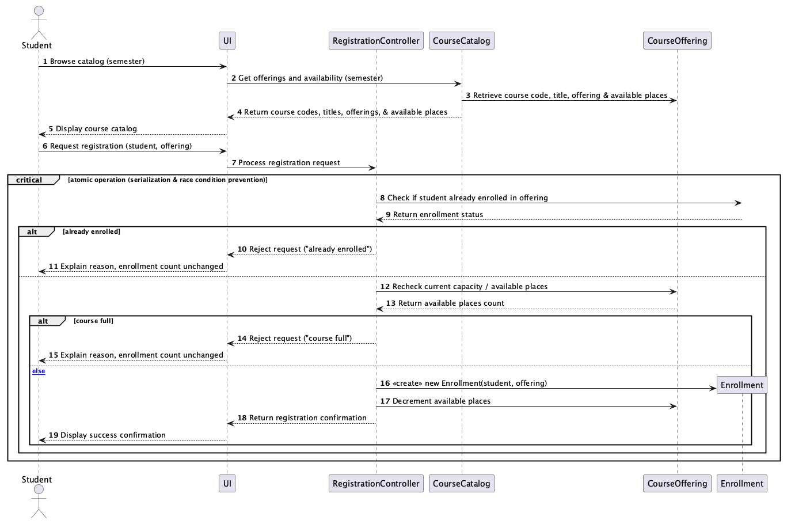
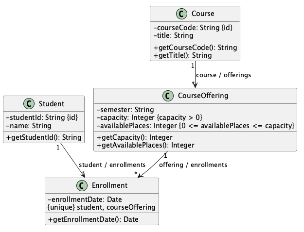
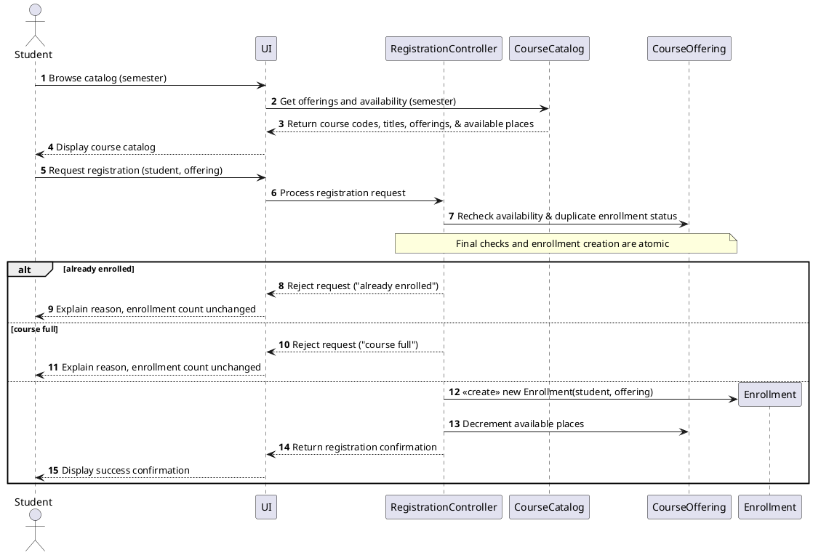
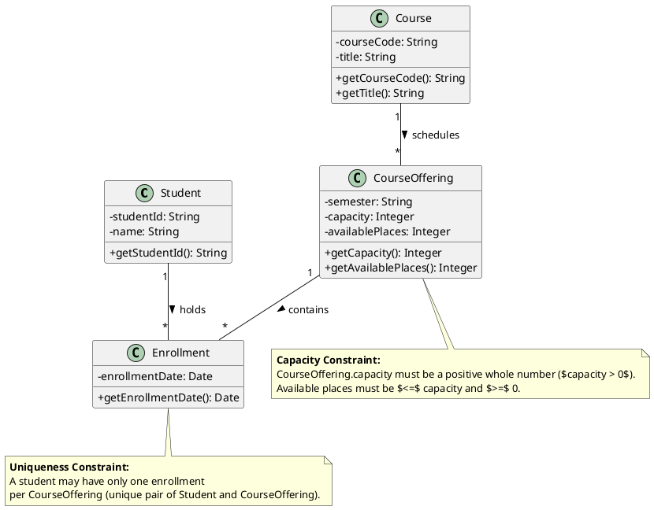
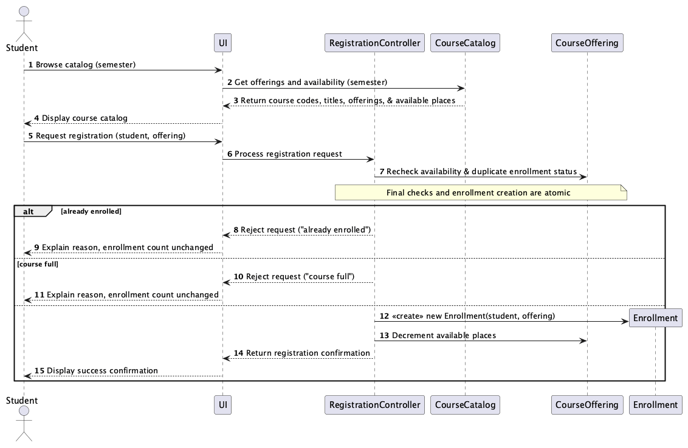
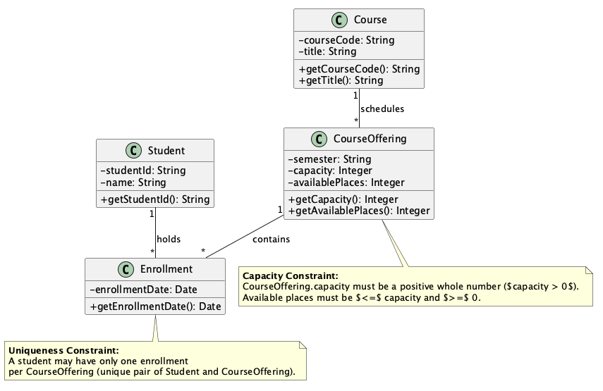

# SIS #02 — AI-Assisted UML Modeling: University Course Registration

<!--
  This is the only file you write your report in. README.md tells you what goes where.

  Rules the checker relies on:
  - Do not delete, rename or renumber the ## headings, the ### headings, or the **Label:** words.
  - Replace every "(write here)" and "(paste here)". None may be left when you submit.
  - Comments like this one are ignored by the checker and the word counter. Delete them or leave them.
-->

## 1. Scope and assumptions

**Scope:** This project models university course registration. Students browse a semester's course catalog, select a specific course offering, and request enrollment. The system checks current capacity and duplicate enrollment before accepting or rejecting a registration request. It supports successful registration and clear rejection for full courses or duplicate requests. Payments, prerequisites, timetable clashes, waiting lists, and cancellation are outside the scope.

**Assumptions:**

1. Students are already signed in, and the selected course offering exists with a positive whole-number capacity.
2. A Course represents a subject, while a CourseOffering represents a specific scheduled section in one semester.

## 2. User stories and acceptance criteria

### US-01 — Browse offerings

**US-01:** As a signed-in student, I want to browse the electronic course catalog for a semester, so that I can see course codes, titles, specific offerings, and available places before deciding to register.

- **AC-01** (R1): Given a signed-in student is browsing the course catalog for a specific semester, When the catalog is loaded, Then the system displays the course code, title, offering, and available places for each course offering.
- **AC-02** (R1): Given a student is viewing available places in the catalog without making a registration request, When the view is rendered, Then no places are reserved or modified.

### US-02 — Register for an offering

**US-02:** As a signed-in student, I want to request enrollment in a specific course offering, so that I can secure a place if capacity allows.

- **AC-03** (R2, R4): Given a signed-in student selects an offering with available capacity and is not already enrolled, When they submit a registration request, Then the system atomically rechecks availability, creates exactly one enrollment linking the student and offering, updates available places, and returns a confirmation.
- **AC-04** (R2, R4): Given competing registration requests target the last remaining place of an offering, When the final checks and enrollment creation are processed, Then the operation executes atomically so that only one request succeeds and capacity is never exceeded.

### US-03 — Receive a clear rejection

**US-03:** As a signed-in student, I want the system to reject invalid enrollment requests with clear explanations, so that my enrollment status remains unchanged if a course is full or if I am already enrolled.

- **AC-05** (R2, R5): Given an offering has zero available places, When a student requests enrollment, Then the system rejects the request, explains "course full", creates no enrollment, and leaves the enrollment count unchanged.
- **AC-06** (R3, R5): Given a student is already enrolled in the selected offering, When the student submits a repeat enrollment request, Then the system rejects the request, explains "already enrolled", creates no new enrollment, and leaves the enrollment count unchanged.


## 3. Sequence diagram

<!-- The FINAL diagram, rendered. Change .png to .svg if that is what you exported. -->



**Participants:** (write here — each lifeline and what it stands for)

**Atomic operation:** (write here — which messages form the one atomic step: the final duplicate check, the capacity check and the creation of the Enrollment, and why a catalog view reserves nothing)

**Where the Enrollment is created:** (write here — which message, which lifeline, and which class in section 4 it produces)

**Technical lifelines:** (write here — every lifeline that is NOT a class in the class diagram, by name, and why the difference in abstraction is fine. "None" if there are none.)

## 4. Class diagram

<!-- The FINAL diagram, rendered. -->



<!-- One row per association in classes.puml, read in both directions. -->

| Association | Read left to right | Read right to left |
| --- | --- | --- |
| (write here) | (write here) | (write here) |
| (write here) | (write here) | (write here) |
| (write here) | (write here) | (write here) |

**How an Enrollment links a student to an offering:** (write here)

**Capacity constraint:** (write here — and why multiplicity alone cannot express it)

**Uniqueness constraint:** (write here — and why multiplicity alone cannot express it)

## 5. Traceability

<!-- Every rule, including the catalog fields and availability (R1). Column 1: the rule and
     the criteria that cover it, e.g. "R2 + AC-03, AC-04". Column 2: the message, guard,
     class or constraint that shows the rule in YOUR diagrams. Column 3: the T-ID that
     exercises it, or the extra check you did instead (R1 has no T case). -->

| Rule and criterion | Model evidence | Validation case |
| --- | --- | --- |
| R1 + (write here) | (write here) | (write here) |
| R2 + (write here) | (write here) | (write here) |
| R3 + (write here) | (write here) | (write here) |
| R4 + (write here) | (write here) | (write here) |
| R5 + (write here) | (write here) | (write here) |

## 6. Walkthroughs

<!-- Walk each case through YOUR final sequence diagram, message by message. Column 2: the
     actual steps and the state change (count before → after). Column 3 starts with Pass or
     Fail, then the location: the message, guard or note where you saw it. A Fail you
     report honestly is a finding, not a penalty. -->

| Case | Observed path and state change | Judgment and evidence |
| --- | --- | --- |
| T1. Available | (write here) | (write here) |
| T2. Last place | (write here) | (write here) |
| T3. Full | (write here) | (write here) |
| T4. Duplicate | (write here) | (write here) |

## 7. Review decisions

<!-- At least three substantive decisions about Prompt C's critique or your own inspection.
     Decision: accepted / rejected / modified — and what you did. Reason: why, in a full
     sentence. Rule: R1–R5. Do not invent an error to fill the table; a justified rejection
     of advice counts. -->

| AI suggestion or model element | Decision | Reason | Rule |
| --- | --- | --- | --- |
| (write here) | (write here) | (write here) | (write here) |
| (write here) | (write here) | (write here) | (write here) |
| (write here) | (write here) | (write here) | (write here) |

## 8. Modeling explanation

<!-- 200–300 words. Your main design choices; how the class diagram and the sequence diagram
     complement each other; why an activity diagram could also help explain the workflow. -->

(write here)

## 9. Reflection

<!-- 150–200 words. Written by you, not by the assistant: where AI helped, one decision you
     made yourself, one remaining limitation. Specific beats flattering. -->

(write here)

## 10. Appendix A — Before AI

**Scope:** This project models university course registration. Students browse a semester's course catalog, select a specific course offering, and request enrollment. The system checks available capacity and duplicate enrollment before accepting or rejecting a registration request.

**Initial assumptions:**

1. Students are already signed in, and the selected course offering exists with a positive whole-number capacity.
2. A Course represents a subject, while a CourseOffering represents a specific scheduled section in one semester.


## 11. Appendix B — AI exchanges

<!-- Complete prompts and complete responses, as text — never screenshots. Paste each inside
     the ~~~~ block that follows its label: AI responses contain ``` PlantUML blocks, and
     ~~~~ keeps them from breaking this file. Prompts B and C: the prompt text first, then
     the material it refers to ("below", "these two") pasted under it, in the same block.
     You may add B5, B6 … after B4 if you ran more. -->

### B1 — Requirements (Prompt A)

- **Tool:** Gemini
- **Model:** Gemini 3
- **Date:** 2026-10-18
- **Purpose:** draft 3 user stories and 6 acceptance criteria

<!-- Model: the exact model with its version, as the tool shows it (e.g. "GPT-5 Thinking",
     "Claude Sonnet 4.5"). If the tool does not show it, write: not displayed
     Date: YYYY-MM-DD -->

**Prompt:**

~~~~text
Act as a requirements analyst. Use only this course registration scenario and rules R1–R5: A student browses an electronic course catalog, chooses a course offering and requests registration. Each offering has a limited number of places. A Course describes a subject. A CourseOffering is one scheduled section in one semester. Registration always targets a specific offering. Assume that the student is signed in, the selected offering exists, and its capacity is a positive whole number.

R1. Catalog: Show the course code, title, offering and available places for one semester.
R2. Capacity: Recheck current availability when registering. Enrollment must never exceed the offering's capacity.
R3. Duplicates: A student may have at most one enrollment in the same offering. Reject a repeat request.
R4. Success: Create exactly one Enrollment linking the student and offering, update availability and return a confirmation.
R5. Rejection: Explain "course full" or "already enrolled". Create no enrollment and leave the enrollment count unchanged.

A catalog view does not reserve a place. Model the final checks and enrollment creation as one atomic operation, so competing requests cannot take the same last place. Out of scope: payments, prerequisites, timetable clashes, waiting lists, cancellation. Use fictional students and courses. Treat any extra AI suggestion as a proposal you accept or reject explicitly. My initial assumptions are Scope: This project models university course registration. Students browse a semester's course catalog, select a specific course offering, and request enrollment. The system checks available capacity and duplicate enrollment before accepting or rejecting a registration request. Initial assumptions: 1. Students are already signed in, and the selected course offering exists with a positive whole-number capacity. 2. A Course represents a subject, while a CourseOffering represents a specific scheduled section in one semester.

Draft 3 user stories and 2 Given / When / Then acceptance criteria for each. Use IDs US-01 to US-03 and AC-01 to AC-06. Map each criterion to rule IDs.
Cover normal and rejection behavior. List uncertainty separately. Do not add excluded features or invent university policies.
~~~~

**Response:**

~~~~text
Here is the requirements analysis based strictly on your scenario and rules R1–R5.

---

### ## User Stories and Acceptance Criteria

#### **US-01: Course Catalog Browsing**

*As a signed-in student, I want to browse the electronic course catalog for a semester, so that I can see course codes, titles, specific offerings, and available places before deciding to register.*

* **AC-01 (Normal Catalog View)**
* **Given** a signed-in student is browsing the course catalog for a specific semester,
* **When** the catalog is loaded,
* **Then** the system displays the course code, title, offering, and available places for each course offering.
* *Mapped Rules:* R1


* **AC-02 (Catalog Non-Reservation)**
* **Given** a student is viewing available places in the catalog without making a registration request,
* **When** the view is rendered,
* **Then** no places are reserved or modified.
* *Mapped Rules:* R1 (Context constraint)


---

#### **US-02: Successful Course Registration**

*As a signed-in student, I want to request enrollment in a specific course offering, so that I can secure a place if capacity allows.*

* **AC-03 (Successful Enrollment)**
* **Given** a signed-in student selects an offering with available capacity and is not already enrolled,
* **When** they submit a registration request,
* **Then** the system atomically rechecks availability, creates exactly one enrollment linking the student and offering, updates the available places count, and returns a confirmation.
* *Mapped Rules:* R2, R4


* **AC-04 (Atomic Concurrent Check)**
* **Given** competing registration requests target the last remaining place of an offering,
* **When** the final checks and enrollment creation are processed,
* **Then** the operation executes atomically so that only one request succeeds and capacity is never exceeded.
* *Mapped Rules:* R2, R4 (Atomic operation constraint)


---

#### **US-03: Enrollment Rejection Handling**

*As a signed-in student, I want the system to reject invalid enrollment requests with clear explanations, so that my status remains unchanged if a course is full or if I am already enrolled.*

* **AC-05 (Rejection - Course Full)**
* **Given** an offering has zero available places,
* **When** a student requests enrollment,
* **Then** the system rejects the request, explains "course full", creates no enrollment, and leaves the enrollment count unchanged.
* *Mapped Rules:* R2, R5


* **AC-06 (Rejection - Already Enrolled)**
* **Given** a student already has an active enrollment in the selected offering,
* **When** the student submits a repeat enrollment request,
* **Then** the system rejects the request, explains "already enrolled", creates no new enrollment, and leaves the enrollment count unchanged.
* *Mapped Rules:* R3, R5


---

### ## Uncertainty List

1. **Concurrency Error Handling:** While AC-04 assumes atomic processing handles competing requests for the last place, the specific error message or feedback returned to the losers of a race condition (e.g., whether they receive "course full") is unspecified.
2. **Explicit Rejection Message Format:** The rules mandate explaining "course full" or "already enrolled", but do not specify whether these are exact string literals required for UI display or general categorical descriptions.

---

### ## AI Proposal Acceptance / Rejection

* **Proposal (Accepted):** Treat atomic execution (AC-04) as an explicit system-level requirement derived from the scenario note ("Model the final checks and enrollment creation as one atomic operation, so competing requests cannot take the same last place") to ensure data integrity.
* **Proposal (Rejected):** Any extension suggesting error logging, audit trails, or database-level lock timeouts, as they fall outside the strict scope of rules R1–R5.
~~~~

### B2 — UML drafts (Prompt B)

- **Tool:** (write here)
- **Model:** (write here)
- **Date:** (write here)
- **Purpose:** draft the sequence and class diagrams

**Prompt:**

~~~~text
Prompt B — UML drafts

Act as a UML modeling assistant. Use only the following university course registration scenario, rules, user stories, and acceptance criteria. Return separate PlantUML code blocks for a sequence diagram and a domain class diagram.

SCENARIO:
A signed-in student browses the course catalog for a specific semester, selects a specific CourseOffering, and requests registration. A Course represents a subject, while a CourseOffering represents one scheduled section of that course in a semester. Each CourseOffering has a positive whole-number capacity.

RULES R1–R5:
R1. The catalog must show the course code, course title, specific offering, and available places for a selected semester.
R2. The system must recheck current availability when a registration request is processed. Capacity must never be exceeded. Viewing the catalog does not reserve a place.
R3. A student may have only one enrollment in the same CourseOffering. Duplicate registration requests must be rejected.
R4. For a valid request, the system must create exactly one Enrollment linking the student and the selected CourseOffering, update availability, and return a confirmation. Final checks and enrollment creation must be atomic.
R5. If the offering is full or the student is already enrolled, the system must explain the reason, create no enrollment, and leave the enrollment count unchanged.

USER STORIES AND ACCEPTANCE CRITERIA:

US-01 — Browse offerings
As a signed-in student, I want to browse the electronic course catalog for a semester, so that I can see course codes, titles, specific offerings, and available places before deciding to register.

AC-01 (R1):
Given a signed-in student is browsing the course catalog for a specific semester, When the catalog is loaded, Then the system displays the course code, title, offering, and available places for each course offering.

AC-02 (R1):
Given a student is viewing available places in the catalog without making a registration request, When the view is rendered, Then no places are reserved or modified.

US-02 — Register for an offering
As a signed-in student, I want to request enrollment in a specific course offering, so that I can secure a place if capacity allows.

AC-03 (R2, R4):
Given a signed-in student selects an offering with available capacity and is not already enrolled, When they submit a registration request, Then the system atomically rechecks availability, creates exactly one enrollment linking the student and offering, updates available places, and returns a confirmation.

AC-04 (R2, R4):
Given competing registration requests target the last remaining place of an offering, When the final checks and enrollment creation are processed, Then the operation executes atomically so that only one request succeeds and capacity is never exceeded.

US-03 — Receive a clear rejection
As a signed-in student, I want the system to reject invalid enrollment requests with clear explanations, so that my enrollment status remains unchanged if a course is full or if I am already enrolled.

AC-05 (R2, R5):
Given an offering has zero available places, When a student requests enrollment, Then the system rejects the request, explains "course full", creates no enrollment, and leaves the enrollment count unchanged.

AC-06 (R3, R5):
Given a student is already enrolled in the selected offering, When the student submits a repeat enrollment request, Then the system rejects the request, explains "already enrolled", creates no new enrollment, and leaves the enrollment count unchanged.

MODELING INSTRUCTIONS:

1. Return two separate PlantUML code blocks: one sequence diagram and one domain class diagram.
2. Sequence diagram:
   - Include catalog browsing and registration.
   - Include named participants and meaningful message names.
   - Show the registration request, duplicate-enrollment check, and current-capacity check.
   - Perform the final checks and enrollment creation as one atomic operation.
   - Include exactly three guarded outcomes:
     a. [already enrolled]
     b. [course full]
     c. [else]
   - The success outcome must create exactly one Enrollment, update availability, and return confirmation only after creation.
   - Rejection outcomes must not create or save an Enrollment, update availability, or return a success confirmation.
   - Include the word "atomic" in a note or group.
   - Do not use square brackets inside the guard text beyond the UML alt/else syntax.
3. Domain class diagram:
   - Include these four classes: Student, Course, CourseOffering, and Enrollment.
   - Include useful attributes.
   - Student must have an identifier.
   - Course must have a course code and title.
   - CourseOffering must have a semester and capacity.
   - Show multiplicities at both ends of every association.
   - Each Enrollment must link exactly one Student and exactly one CourseOffering.
   - State the capacity constraint and the uniqueness constraint separately as notes.
   - Do not add extra classes unless necessary; if you add one, include a PlantUML comment explaining why.
4. Explain any assumptions and technical lifelines after the diagrams.
5. Do not add features outside the stated scope, such as payments, prerequisites, timetable clashes, waiting lists, or cancellation.
6. Return valid PlantUML syntax that can be saved directly into .puml files.
~~~~

**Response:**

~~~~text
Here are the PlantUML diagrams and supporting explanations for the university course registration scenario, structured according to your rules and user stories.

---

### 1. Sequence Diagram



---

### 2. Domain Class Diagram



---

### 3. Assumptions and Technical Lifelines

* **Technical Lifelines & Architecture:**
* **UI / Boundary:** Acts as the interface handling student inputs (browsing and clicking register) and rendering messages.
* **RegistrationController:** Orchestrates the workflow, managing transactional boundaries and invoking domain checks.
* **CourseCatalog:** Acts as a query service retrieving read-only catalog projections for a specific semester without locking or reserving seats (satisfying R1 and R2).
* **CourseOffering & Enrollment (Entities):** Maintain core state. State validation and atomic mutations occur at this layer.


* **Atomicity & Concurrency:** The atomic block ensures that check-then-act race conditions (such as two students competing for the last available place) are handled safely at the data/controller boundary, allowing only one transaction to succeed (satisfying R4 and AC-04).
* **State Immutability on Rejection:** Rejection branches ensure that no `Enrollment` instance is instantiated or persisted, and available place counters remain completely untouched (satisfying R5).
~~~~

### B3 — Model critique (Prompt C) 

- **Tool:** (write here)
- **Model:** (write here)
- **Date:** (write here)
- **Purpose:** review both models against R1–R5 and T1–T4

**Prompt:**

~~~~text
(paste here)
~~~~

**Response:**

~~~~text
(paste here)
~~~~

### B4 — Focused revision (Prompt D)

- **Tool:** (write here)
- **Model:** (write here)
- **Date:** (write here)
- **Purpose:** apply my accepted review decisions

**Prompt:**

~~~~text
(paste here)
~~~~

**Response:**

~~~~text
(paste here)
~~~~

## 12. Appendix C — Original diagrams

<!-- The AI's first output from Prompt B, rendered unedited from models/original/. -->





## 13. Appendix D — References and source checks

### References

<!-- Full references, one per line, each starting with "- ". Only sources you actually opened.
     Every URL used in the source checks must also appear here. Example:
     - Sommerville, I. (2016). Software Engineering, 10th ed., Global Edition. Pearson. Ch. 5. -->

- (write here)

### Source checks

<!-- At least two modeling decisions you verified. Source and locator: title + slide, page,
     section, chapter or figure — or title + URL + access date (YYYY-MM-DD). Slide numbers
     refer to the decks posted in our Teams. -->

| Modeling decision | Source and locator | What the source says | How it supports or changed your model |
| --- | --- | --- | --- |
| (write here) | (write here) | (write here) | (write here) |
| (write here) | (write here) | (write here) | (write here) |
